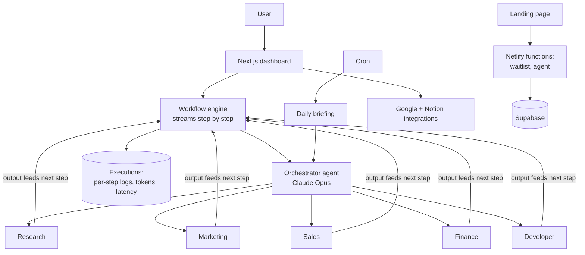

# NYX

An autonomous AI operating system: a marketing site with a waitlist, and a dashboard where a team of AI agents researches, plans and reports for you.

**Live:** https://nyxsystem.online · **Built:** 39 commits, Jun 8 – Oct 14, 2026 · solo

## By the numbers (each links to the proof)

| | |
|---|---|
| 6 agents: 1 Claude Opus orchestrator + 5 Claude Sonnet specialists | [`dashboard/lib/claude.ts`](dashboard/lib/claude.ts) |
| 54 API routes | [`dashboard/app/api/`](dashboard/app/api/) |
| 6 SQL migrations with row-level security | [`dashboard/supabase/migrations/`](dashboard/supabase/migrations/) |
| Audit health score 71 → 100 | [`NYX_AUDIT_REPORT.md`](NYX_AUDIT_REPORT.md) |
| ~10,200 lines of TypeScript | `git ls-files '*.ts' '*.tsx' \| xargs cat \| wc -l` |

## Architecture



- **Hierarchical delegation:** the orchestrator splits work across specialist agents; each step's output is substituted into the next step's prompt ([`dashboard/lib/workflow/engine.ts`](dashboard/lib/workflow/engine.ts)).
- **State and tracing:** every run is stored as an execution with per-step logs, tokens used and duration.
- **Hardening:** cron refuses unauthenticated calls, admin routes need an allowlist, rate limiting uses Redis across instances with a memory fallback ([`netlify/lib/shared.js`](netlify/lib/shared.js), tested in [`tests/`](tests/)).

## Run it

```bash
npm install && npm test          # Vitest: rate limiter + email validation
cd dashboard && npm install
cp .env.local.example .env.local # Supabase + Anthropic keys
npm run dev
```

**Stack:** Next.js · TypeScript · Supabase · Anthropic API · Netlify Functions · Resend · Upstash Redis · Vitest
